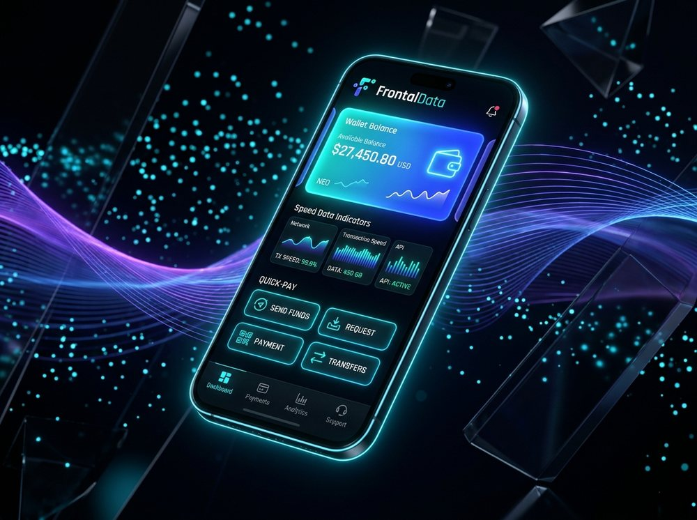

# FrontalData ⚡ Next-Gen VTU & Telecom Automation Platform

<p align="center">
  
</p>

<p align="center">
  <strong>Enterprise-grade Nigerian Telecom & Utility Bills Automation Engine</strong><br />
  Instant SME Data • Airtime VTU • Electricity Tokens • Cable TV • Exam PINs • Virtual Accounts
</p>

<p align="center">
  <a href="https://frontaldata.academyhub.com.ng"></a>
  
  
  
  
  
</p>

---

## 🌟 Overview

**FrontalData** is a modern, high-throughput Virtual Top-Up (VTU) and digital bill payment platform engineered for Nigerian fintech consumers, enterprise resellers, and telecom agents. Built on **Laravel 10**, styled with a custom neo-fintech **Tailwind CSS** design system, and powered by automated multi-provider switching, FrontalData processes telecom and utility transactions in under 5 seconds with 99.9% delivery reliability.

<p align="center">
  
</p>

---

## 🚀 Key Platform Features

### ⚡ Telecom Services Automation
- **Instant SME & Corporate Gifting Data**: Wholesale automated data vending across MTN, Airtel, Glo, and 9mobile with real-time balance validation.
- **Airtime Top-Up (VTU & Share 'n' Sell)**: Sub-3-second airtime delivery with customizable reseller discounts (up to 3-5% off).
- **Automated Failover & Multi-Provider Routing**: Seamless fallback routing across telecom API gateways to prevent transaction failures during network downtimes.

### 💡 Utility & Cable Subscriptions
- **Electricity Tokens**: Real-time meter token vending for all major DISCOs (IKEDC, EKEDC, AEDC, IBEDC, KEDCO, EEDC, JED, PHED, BEDC). Supports prepaid token generation & postpaid bill settlement.
- **Cable TV Renewal**: Instant smartcard/IUC validation and package activation for DStv, GOtv, and Startimes.
- **Educational Vouchers**: Automated scratch card PIN delivery for WAEC, NECO, NABTEB, and JAMB result verification.
- **Sports Betting Funding**: Direct instant wallet funding for SportyBet, Bet9ja, 1xBet, BangBet, and Merrybet.

### 🏦 Dedicated Automated Virtual Accounts & Payments
- **Dynamic Virtual Account Numbers**: Automated creation of dedicated bank accounts (Wema Bank, Sterling Bank, Moniepoint) for each user.
- **Instant Payment Webhooks**: Real-time payment verification and instant wallet crediting powered by Monnify, Payvessel, Squad, and Paystack.
- **Direct Wallet Transfers**: Seamless peer-to-peer wallet transfers between registered users.

### 🛡️ Bank-Grade Security & KYC Verification
- **Automated Identity Verification (KYC)**: Tiered transaction limits unlocked via real-time BVN (Bank Verification Number) and NIN (National Identification Number) verification in compliance with CBN and NDPR regulations.
- **4-Digit Payment Authorization PIN**: Cryptographically secured transaction PIN required for wallet debits.
- **Session Protection**: Device-binding, CSRF verification, rate limiting, and brute-force prevention.

### 💼 VIP Reseller & Agency Engine
- **Multi-Tier Hierarchy**: Smart pricing engine supporting *Customer*, *Reseller*, and *VIP Agent* tiers with automated margin calculation.
- **Referral & Commission Tracking**: Multi-level referral program with automated commission payouts into separate bonus wallets.
- **Cashback & Promo Banners**: Promotional banner engine highlighting volume discounts and seasonal deals.

### 📱 Progressive Web App (PWA) & Offline Resilience
- **Aggressive Cache-First Service Worker (v1.2.0)**: Automatic caching and pre-caching of all static visual assets, stylesheets, scripts, and fonts.
- **Native-Like Mobile Experience**: Mobile bottom navigation bar (`<x-app.btm />`), top navigation header, touch gesture support, and standalone display mode for home screen installation.

### 🔌 Developer REST API
- **Full Partner API Suite**: RESTful JSON endpoints for data topups, airtime, validations, and balance lookups.
- **Bearer Token Authentication**: Secure developer tokens with dedicated API documentation and interactive endpoint testing console.

---

## 🛠️ Technology Stack

| Layer | Technology | Details |
|---|---|---|
| **Backend Framework** | **Laravel 10.x** | PHP 8.2+, Eloquent ORM, Blade Component Engine |
| **Frontend Styling** | **Tailwind CSS 3.x** | Custom Royal Blue Fintech Palette (`#0066FF`), Responsive Grid System |
| **Icons & Visuals** | **RemixIcons & 3D Renderings** | High-fidelity 3D assets, vector iconography |
| **Client-Side Scripts** | **Alpine.js & Vanilla JS** | Lightweight reactive state, asynchronous form handlers |
| **Offline & PWA** | **Custom Service Worker** | Dedicated `IMAGE_CACHE_NAME` storage, fast asset loading |
| **Database** | **MySQL 8.0 / MariaDB** | ACID-compliant transaction ledgers with foreign key integrity |
| **Production Runtime** | **Docker Container** | Containerized LAMP stack with Nginx reverse proxy & Cloudflare SSL |

---

## 📂 Project Architecture

```
├── app/
│   ├── Http/Controllers/     # CoreController, AdminController, Auth controllers
│   ├── Models/               # User, Transaction, Service, Product, Provider, etc.
│   ├── Providers/            # ThemeServiceProvider, RouteServiceProvider, etc.
│   └── Plugins/              # Hook listeners and modular service extensions
├── config/                   # Laravel framework & service configuration
├── database/                 # Migrations, seeders, and schema definitions
├── public/
│   ├── images/               # FrontalData 3D icons, logo, banners, hero showcase
│   ├── css/ & js/            # Compiled frontend assets and utility scripts
│   ├── sw.js                 # PWA Service Worker (Cache-first image strategy)
│   └── manifest.json         # Web App Manifest for mobile installation
├── resources/
│   ├── themes/
│   │   ├── default/          # Primary FrontalData production theme
│   │   │   ├── components/   # Modern Blade components (aside, header, btm, cards)
│   │   │   ├── core/         # User dashboard, KYC, support, services, profile
│   │   │   ├── layouts/      # Main application layout, auth layout, form layout
│   │   │   └── services/     # Airtime, Data, TV, Electricity, Exam PIN views
│   │   └── smedata/          # Legacy compatibility fallback theme
│   └── views/                # Admin panels, email templates, and shared layouts
└── routes/
    ├── web.php               # Core web routing & setup middleware
    ├── auth.php              # Authentication & registration routes
    ├── core.php              # Authenticated user telecom & billing services
    ├── dev.php               # Public & partner developer API documentation
    └── admin.php             # Comprehensive admin management console
```

---

## ⚙️ Quick Start & Local Setup

### 1. Clone the Repository
```bash
git clone https://github.com/yaseeradam/FrontalData.git
cd FrontalData
```

### 2. Install PHP & Node Dependencies
```bash
composer install --no-dev --optimize-autoloader
```

### 3. Environment Configuration
Copy `.env.example` to `.env`:
```bash
cp .env.example .env
```
Generate the application encryption key:
```bash
php artisan key:generate
```
Configure your database and payment gateway credentials in `.env`:
```ini
APP_NAME=FrontalData
APP_ENV=production
APP_DEBUG=false
APP_URL=https://frontaldata.academyhub.com.ng

DB_CONNECTION=mysql
DB_HOST=127.0.0.1
DB_PORT=3306
DB_DATABASE=frontaldata_db
DB_USERNAME=frontaldata_user
DB_PASSWORD=your_secure_password
```

### 4. Run Migrations & Seeders
```bash
php artisan migrate --force
```

### 5. Storage Symlink & Cache Optimization
```bash
php artisan storage:link
php artisan config:cache
php artisan route:cache
php artisan view:cache
```

### 6. Start Local Development Server
```bash
php artisan serve
```
Visit `http://localhost:8000` to preview the application.

---

## 🚢 Production Deployment

FrontalData is built for seamless deployment in Dockerized container environments with Nginx reverse proxying and Cloudflare SSL termination.

```bash
# Clear existing view and route caches inside container
docker exec frontalminds-vtu php artisan optimize:clear
docker exec frontalminds-vtu php artisan view:cache
docker exec frontalminds-vtu php artisan route:cache
docker exec frontalminds-vtu php artisan config:cache
```

### Nginx Static Caching Directive
```nginx
location ~* \.(?:jpg|jpeg|gif|png|ico|cur|gz|svg|svgz|mp4|ogg|ogv|webm|htc|woff2|woff)$ {
    expires 365d;
    add_header Cache-Control "public, max-age=31536000, immutable";
    access_log off;
}
```

---

## 🔒 Security Best Practices

- **Zero-Trust Input Sanitization**: All incoming payload parameters are validated with strict regex patterns and integer constraints.
- **Idempotent Webhooks**: Virtual account transactions are validated with database unique constraints to eliminate duplicate wallet fundings.
- **Encrypted PIN Storage**: Transaction PINs are hashed using bcrypt before persistent storage.
- **Production Guardrails**: `.env` and sensitive runtime assets are strictly excluded from version control via `.gitignore`.

---

## 👨‍💻 Maintainer & Author

- **Platform Architect**: [Yaseer K Adam](https://github.com/yaseeradam)
- **Organization**: [FrontalData](https://frontaldata.academyhub.com.ng) / [AcademyHub](https://academyhub.com.ng)
- **Support Contact**: `support@frontaldata.academyhub.com.ng`

---

<p align="center">
  <sub>© 2026 FrontalData. All Rights Reserved. Built with pride for the Nigerian Digital Economy.</sub>
</p>
